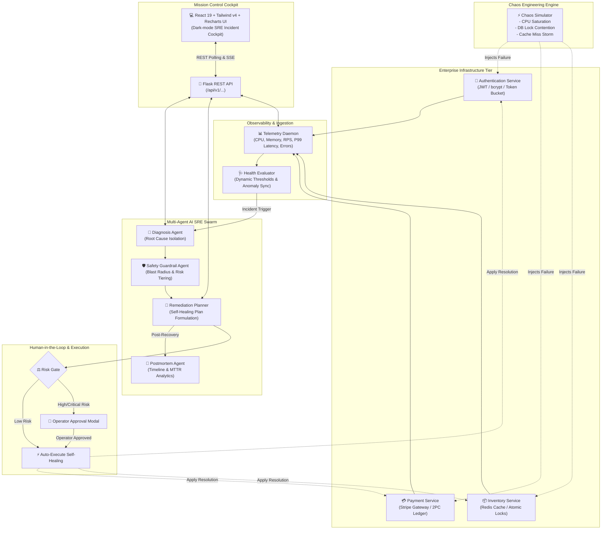

# 🛡️ Sentinel AI Ops
### **Autonomous Infrastructure Monitoring, Chaos Engineering & Intelligent Incident Remediation**

[](https://github.com)
[](https://python.org)
[](https://react.dev)
[](https://vitejs.dev)
[](https://tailwindcss.com)
[](https://flask.palletsprojects.com)
[](https://pytest.org)
[](LICENSE)

---

## ⚡ Executive Summary

**Sentinel AI Ops** is an enterprise-grade Autonomous Incident Commander and Site Reliability Engineering (SRE) cockpit. Built to solve high-stress outages in high-velocity microservice architectures, Sentinel bridges the gap between **passive observability** and **actionable, safe self-healing**.

Traditional monitoring tools (Datadog, Grafana, New Relic) alert human engineers at 3:00 AM, leaving teams scrambling through fragmented dashboards, scattered logs, and uncoordinated runbooks. **Sentinel replaces reactive human toil with an autonomous multi-agent AI swarm** that:
1. **Detects** telemetry anomalies before they trigger critical customer SLA breaches.
2. **Diagnoses** root causes across distributed services using cross-telemetry correlation.
3. **Validates** blast radius and risk through an automated **Safety Guardrail Engine**.
4. **Remediates** failure modes autonomously (for low-risk actions) or surfaces **one-click Human-in-the-Loop (HITL) approvals** for high-risk interventions.
5. **Generates** blameless, audit-ready postmortems with complete timeline reconstruction.

---

## 📑 Table of Contents

- [Executive Summary](#-executive-summary)
- [System Architecture](#-system-architecture)
- [The 3 Core Microservices](#-the-3-core-microservices)
- [Autonomous Multi-Agent AI Swarm](#-autonomous-multi-agent-ai-swarm)
- [Chaos Engineering Lab](#-chaos-engineering-lab)
- [Human-in-the-Loop (HITL) Governance](#-human-in-the-loop-hitl-governance)
- [UI / UX Cockpit Design](#-ui--ux-cockpit-design)
- [Technology Stack](#-technology-stack)
- [Local Setup & Quickstart](#-local-setup--quickstart)
- [REST API Reference](#-rest-api-reference)
- [Testing & Quality Verification](#-testing--quality-verification)
- [Git Promotion & Release Workflow](#-git-promotion--release-workflow)
- [Team & Acknowledgments](#-team--acknowledgments)

---

## 🏛️ System Architecture

Sentinel AI Ops decouples infrastructure telemetry, chaotic failure injection, intelligent agent reasoning, and interactive cockpit visualization into a clean, event-driven reactive architecture.



---

## 🌐 The 3 Core Microservices

Sentinel models an enterprise commerce backend comprising three high-throughput microservices:

| Service | Architecture & Purpose | Failure Modes Simulated | Healthy Baseline |
| :--- | :--- | :--- | :--- |
| **Authentication Service** | Handles user sessions, JWT issuance, OAuth verification, and bcrypt hashing. | CPU thread pool exhaustion, cryptographic looping, runaway auth regex. | CPU: 28% • Mem: 42% • Latency: 45ms • Error: 0.1% |
| **Payment Service** | Processes credit card transactions, Stripe gateway webhooks, and double-entry ledger settlement. | Database lock contention, deadlocks, connection pool depletion. | CPU: 32% • Mem: 55% • Latency: 120ms • Error: 0.05% |
| **Inventory Service** | Manages real-time catalog stock, warehouse synchronization, and atomic item reservations. | Redis cache eviction, cache stampedes, hot-key database query cascades. | CPU: 25% • Mem: 38% • Latency: 25ms • Error: 0.0% |

---

## 🤖 Autonomous Multi-Agent AI Swarm

Sentinel orchestrates specialized AI agents that operate as a collaborative SRE incident response pod. Each agent has a dedicated responsibility, deterministic fallback rules, and verifiable audit logging.

```
                  +-----------------------------------+
                  |   🚨 Incident Trigger Detected    |
                  +-----------------------------------+
                                    |
                                    v
                  +-----------------------------------+
                  |   1. Root-Cause Diagnosis Agent   |
                  |   Identifies causal root factor   |
                  +-----------------------------------+
                                    |
                                    v
                  +-----------------------------------+
                  |   2. Safety Guardrail Agent       |
                  |   Evaluates blast radius & risk   |
                  +-----------------------------------+
                                    |
                                    v
                  +-----------------------------------+
                  |   3. Remediation Planner Agent    |
                  |   Generates self-healing actions  |
                  +-----------------------------------+
                                    |
                                    v
                  +-----------------------------------+
                  |   4. Human-in-the-Loop Sign-off   |
                  |   Low Risk: Auto  |  High: Manual |
                  +-----------------------------------+
                                    |
                                    v
                  +-----------------------------------+
                  |   5. Blameless Postmortem Agent   |
                  |   Auto-generates markdown report  |
                  +-----------------------------------+
```

### 1. Diagnosis Agent (`backend/agents/diagnosis_agent.py`)
- Analyzes multi-dimensional telemetry (CPU saturation, memory allocation, latency spikes, error rate deviation).
- Cross-correlates symptoms with active service dependencies.
- Powered by LLMs (Groq / Gemini) with an embedded **Deterministic SRE Heuristic Engine** for instant sub-millisecond triage even without external API keys.

### 2. Safety Guardrail Agent (`backend/agents/safety_agent.py`)
- Assesses blast radius, data loss potential, and user downtime before any remediation is attempted.
- Assigns strict risk tiers: `LOW`, `MEDIUM`, `HIGH`, `CRITICAL`.
- Halts dangerous automatic actions (e.g., dropping tables, restarting primary databases during peak hours).

### 3. Remediation Planner (`backend/agents/remediation_agent.py`)
- Produces prioritized step-by-step remediation runbooks.
- Supports actions including:
  - Rolling pod restarts and thread pool expansion
  - Redis cache warming and circuit breaker engagement
  - Read replica failover and connection pool scaling

### 4. Blameless Postmortem Agent (`backend/agents/postmortem_agent.py`)
- Automatically generates comprehensive post-incident postmortems following Google SRE best practices.
- Calculates exact Mean Time to Detect (MTTD), Mean Time to Acknowledge (MTTA), and Mean Time to Resolve (MTTR).
- Exports formatted Markdown documentation ready for engineering retrospectives.

---

## 🧪 Chaos Engineering Lab

Sentinel includes an interactive Chaos Fault Injector that allows operators and judges to induce deterministic failures across microservices with a single click:

| Chaos Scenario | Target Service | Induced Failure | Observable Symptom | Automated Remediation |
| :--- | :--- | :--- | :--- | :--- |
| **CPU Thread Saturation** | `Authentication` | Runaway cryptographic hashing loop consumes 100% vCPU. | CPU $\ge 95\%$, P99 latency jumps from 45ms to 850ms, health turns `CRITICAL`. | Dynamic autoscaling, thread isolation, and traffic shedding. |
| **Database Lock Contention** | `Payment` | Long-running transaction locks ledger rows; connection pool exhausts. | Active DB connections hit 100%, 504 Gateway Timeouts spike to 18%. | Killing blocking transaction PIDs and recycling connection pool. |
| **Redis Cache Miss Storm** | `Inventory` | Cache eviction causes 100% of read requests to bypass cache to PostgreSQL. | Redis hit rate drops to 0%, database read IOPS spike, P99 reaches 1.2s. | Engaging circuit breakers, warming cache, and applying read rate limits. |

---

## ⚖️ Human-in-the-Loop (HITL) Governance

In high-stakes enterprise systems, full unattended autonomy can cause catastrophic unintended consequences. Sentinel implements a tunable **Safety & Governance Model**:

1. **Low-Risk Tiers (`LOW`, `MEDIUM`)**:
   - Cache flushes, read-replica traffic rerouting, log verbosity adjustments.
   - Executed automatically by the Remediation Planner.
2. **High-Risk Tiers (`HIGH`, `CRITICAL`)**:
   - Primary database failovers, service restarts, thread pool expansions, hard process terminations.
   - Quarantined behind an interactive **Operator Approval Gate**.
   - Displays risk analysis, estimated blast radius, and recovery ETA before the operator confirms execution.

---

## 💻 UI / UX Cockpit Design

The frontend is crafted following the modern aesthetic of **Linear**, **Datadog**, and **Vercel**:

- **Dark-Mode Incident Cockpit**: High-contrast, clean typography, and zero visual clutter.
- **Microservices Health Topology**: Real-time status cards for Authentication, Payment, and Inventory with live latency, CPU sparklines, and status badges (`HEALTHY`, `DEGRADED`, `CRITICAL`).
- **Telemetry Charts**: Interactive time-series charts powered by Recharts showing CPU utilization, memory pressure, and request latency over time.
- **Chaos Injection Dock**: One-click scenario buttons with active status indicators.
- **Live AI Diagnosis & Remediation Stream**: Real-time agent thought logs, confidence scores, and root-cause explanations.
- **One-Click Remediation Modal**: Highlighting human sign-off prompts with visual countdowns and execution feedback.
- **Audit Activity Feed**: Chronological log of system warnings, agent decisions, and operator interventions.

---

## 🛠️ Technology Stack

```
Frontend:
├── React 19.0 (Latest React with Concurrent Features)
├── Vite 6.0 (Sub-second HMR and bundling)
├── Tailwind CSS v4.0 (Next-generation utility styling)
├── Recharts (High-performance telemetry time-series charts)
├── Lucide React (Crisp iconography)
└── Framer Motion (Smooth UI micro-interactions)

Backend:
├── Python 3.11+
├── Flask 3.0 (RESTful microservice controller)
├── Flask-CORS (Cross-Origin Resource Sharing)
└── Pytest (Automated test runner and litmus test suite)

AI & Agents:
├── Groq API (High-speed Llama-3 inference)
├── Google Gemini API (Deep reasoning and multi-modal triage)
└── Sentinel Heuristic Engine (Offline deterministic fallback)

Persistence & Telemetry:
├── In-Memory State Store (Real-time telemetry cache)
├── Event Log Store (Audit trail and incident lifecycle tracking)
└── Oracle / SQL Schema (Enterprise-ready relational schema)
```

---

## 🚀 Local Setup & Quickstart

Clone the repository and run both the backend and frontend in minutes.

### Prerequisites
- **Python 3.11+** installed.
- **Node.js 18+** & **npm** installed.
- Git.

### 1. Clone the Repository
```bash
git clone https://github.com/ShyamChl/Sentinel-incident-commander.git
cd Sentinel-incident-commander
```

---

### 2. Backend Setup

#### **Windows (PowerShell)**:
```powershell
# 1. Create and activate virtual environment
python -m venv venv
.\venv\Scripts\activate

# 2. Install dependencies
pip install -r requirements.txt

# 3. (Optional) Set API keys in .env for live LLM inference
# GROQ_API_KEY=your_key_here
# GEMINI_API_KEY=your_key_here

# 4. Start the Flask Backend Server
python -m backend.api.app
```

#### **macOS / Linux**:
```bash
# 1. Create and activate virtual environment
python3 -m venv venv
source venv/bin/activate

# 2. Install dependencies
pip install -r requirements.txt

# 3. Start the Flask Backend Server
python3 -m backend.api.app
```

> The Backend will start on **`http://127.0.0.1:5000`**.

---

### 3. Frontend Setup

In a separate terminal window:

```bash
# 1. Navigate into the frontend directory
cd frontend

# 2. Install Node dependencies
npm install

# 3. Start the Vite development server
npm run dev
```

> The Mission Control Cockpit will open on **`http://localhost:5173`**.

---

## 📡 REST API Reference

All backend endpoints are prefixed with `/api/v1` or available at root:

| Method | Endpoint | Description |
| :--- | :--- | :--- |
| `GET` | `/` | System health check and API status. |
| `GET` | `/incidents` | Fetch all historical and active incidents. |
| `GET` | `/incidents/open` | Fetch currently active / unresolved incidents. |
| `POST` | `/simulation/failure` | Trigger chaos scenario (`cpu_saturation`, `db_lock_contention`, `cache_miss_storm`). |
| `POST` | `/simulation/reset` | Reset all services to healthy baseline metrics. |
| `GET` | `/metrics` | Stream latest telemetry (CPU, memory, latency, RPS) for all services. |
| `GET` | `/diagnosis/<incident_id>` | Request multi-agent root-cause diagnosis. |
| `POST` | `/remediation/<incident_id>` | Formulate and execute remediation plan (with approval check). |
| `POST` | `/remediation/<incident_id>/approve` | Operator approval to execute quarantined high-risk remediation. |
| `GET` | `/postmortem/<incident_id>` | Retrieve blameless postmortem report. |
| `GET` | `/audit/logs` | Fetch real-time system audit logs. |

---

## 🧪 Testing & Quality Verification

Sentinel strictly adheres to a **Zero-Margin Gate** for all pull requests and code modifications:

### 1. Backend Test Suite (Pytest)
```bash
# Must pass 100% with 0 failures
python -m pytest
```
*Output: `9 passed in ~4.9s (100%)`*

### 2. Frontend Lint Check
```bash
cd frontend
npm run lint
```
*Output: `0 errors, 0 warnings`*

### 3. Frontend Production Build
```bash
cd frontend
npm run build
```
*Output: `built in ~800ms with 0 errors`*

---

## 🔄 Git Promotion & Release Workflow

Our repository follows a strict multi-tier branch promotion workflow governed by automated litmus checks:

```
[Feature Branch] ──> [Litmus Tests: 100% Pytest + ESLint + Build] ──> [dev Branch]
                                                                         │
                                                                   (Zero Conflicts)
                                                                         │
                                                                         v
                                                                   [main Branch]
```

1. **Development (`dev`)**: All new features, agents, and UI enhancements are committed to `dev` first.
2. **Pre-flight Litmus Check**: Every commit must pass all backend unit tests and frontend production builds.
3. **Zero-Margin Gate for Production (`main`)**: Changes are only merged into `main` after complete local verification with zero errors and zero conflicts.

---

## 🏆 Presentation & Live Demo Structure (Zeta Innovate Top 200)

For judges and evaluators reviewing the live demonstration:

- **0:00 - 1:30 | The Hook**: The 3:00 AM PagerDuty nightmare — why alert fatigue and manual runbooks cost enterprises millions.
- **1:30 - 3:00 | Architecture**: How Sentinel decouples telemetry ingestion, chaos injection, multi-agent reasoning, and human-in-the-loop governance.
- **3:00 - 8:00 | Live Demo**:
  1. Show healthy baseline telemetry on the 3 core microservices.
  2. Inject **CPU Thread Saturation** chaos into the Authentication Service.
  3. Watch the anomaly detection trigger an incident and stream live agent diagnosis.
  4. Review the **High-Risk Remediation Gate** and click **"Approve & Execute Resolution Now"**.
  5. Watch metrics instantly recover to healthy baseline and review the auto-generated postmortem.
- **8:00 - 10:00 | Impact & Future Scope**: Scaling to Kubernetes eBPF telemetry, enterprise Slack/PagerDuty integrations, and predictive incident prevention.

---

## 📄 License

This project is licensed under the **MIT License** — see the [LICENSE](LICENSE) file for details.

---

<p align="center">
  <b>Built with ❤️ by the Sentinel AI Ops Team for Zeta Innovate 2026.</b>
</p>
